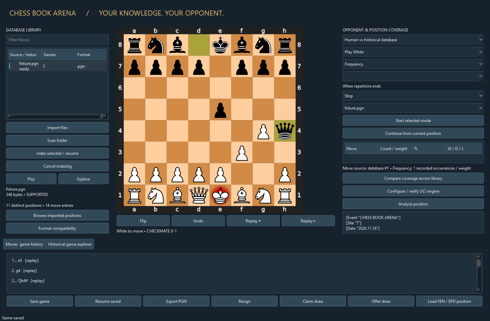

# CHESS BOOK ARENA 0.1.0

A Windows desktop chess workstation that turns imported PGN games and Polyglot books into selectable opponents. Historical and engine moves have separate source labels. This is an initial, unsigned release, not a claim of historical-player strength or proven million-game throughput.

## Run

Download **CHESS-BOOK-ARENA-Setup.exe** from Releases and install for the current Windows user. Alternatively extract the entire portable ZIP and run **CHESS-BOOK-ARENA.exe**. Keep its `_internal` directory beside it. Python is not required for either distribution. Windows may warn about the unsigned executable.

1. Choose **Scan folder**, optionally include subfolders, select a source, then **Index selected / resume**. Or use **Import files**.
2. Wait for `ready`. Inspect the source panel for errors, size, distinct positions and move entries.
3. Select **Human vs historical database** or **Human vs opening book**, White/Black, and a selection strategy. Click **Start selected mode**; enter zero minutes to disable clocks.
4. Click or drag pieces. The candidates table shows actual counts, percentages and W/D/L results. Book weights are not game counts or historical results.
5. At coverage end, stop, explicitly configure an engine/alternate, or undo and **Continue from current position**.
6. Save, resume, or export PGN using the bottom controls. Historical game explorer supports metadata/year/result/position filtering, replay, selected-game export and variation browsing.

All nine mode entry points appear in the mode menu. FEN/EPD imports are available through **Browse imported positions**. Position training also accepts pasted FEN/EPD. Historical player mode is an observable repertoire simulation; only the selected player's actual recorded moves are eligible.

## Engine

Stockfish is optional and is **not bundled**. Select an existing UCI executable in **Configure / verify UCI engine**. The application checks supported options before configuring threads/hash/strength. Set time, depth and MultiPV there. Automatic discovery checks PATH and the optional `CHESS_ARENA_ENGINE` environment variable; arbitrary disk scans are not performed. Pure database and book play do not require an engine. Engine-assisted mode ranks only imported candidate moves; fallback is explicitly labeled `engine fallback`.

## Formats

| Format | Status | Evidence / boundary |
|---|---|---|
| PGN, PGN.GZ | SUPPORTED | Streaming multi-game fixture import, indexing, legal historical play |
| Polyglot BIN | SUPPORTED | Sorted standard 16-byte entries, python-chess hash/move decoding, legal candidate filtering, weighted selection; synthetic fixture verified |
| FEN, EPD | SUPPORTED | Validated position imports and training selection |
| ZIP | SUPPORTED | PGN/PGN.GZ/FEN/EPD streams; BIN extracted to derived storage; 2 GiB/member limit |
| CBH, CBV, CTG, ABK | UNSUPPORTED | No tested native parser or verified converter installed for this product |
| SI4, SG4, SN4, SCID4 | UNSUPPORTED | Component extensions recognized; no tested database-set reader |

No format is currently classified CONVERSION REQUIRED or EXPERIMENTAL: no converter integration has been verified. For other formats, use the originating application's PGN export, then import that PGN. This is a manual suggestion, not tested compatibility. Extension recognition is separate from import success. The bundled examples are intentionally synthetic, not historical data.

## Data and integrity

Sources are read only. SQLite indexes, source metadata, saved games, archive-book derivatives and settings live under `%LOCALAPPDATA%\ChessBookArena`. No enormous PGN copy is made. A source's size and nanosecond modification time detect changes; reindex clears its old derived entries. Reimport resumes by streaming from the beginning and skipping already committed game digests. It does not seek directly to a compressed offset. Identical games within a source are counted once; identical games in separate sources remain separate. Position keys include piece placement, side, castling rights and legally relevant en passant; move counters are excluded. Automatic draws use the actual game history, not the position index.

Cancel finishes the current game transaction. Failed sources retain completed games for later recovery and report errors. Per-game transactions bound memory to one parsed game plus its move list. Extremely large individual games/variation trees can still require significant memory. Never rely on an interrupted index as complete.

## Build and test

PowerShell 7, Python 3.11–3.15 (tested on 3.14), PySide6 6.11, chess 1.11.2 and PyInstaller 6.22.3:

```powershell
python -m venv .venv
.\.venv\Scripts\python.exe -m pip install -e .[dev]
.\scripts\Build.ps1
```

Compile `scripts/installer.iss` with Inno Setup 7 to produce the setup executable. Qt is dynamically shipped with its license materials; python-chess and this application are GPL v3 or later. Stockfish is external. See THIRD-PARTY.md. The exact API behavior follows the upstream [python-chess documentation](https://python-chess.readthedocs.io/en/stable/) and [Qt deployment guidance](https://doc.qt.io/qtforpython-6/deployment/deployment-pyinstaller.html).

## Verification and limits

See [test report](docs/TEST-REPORT.md), [architecture](docs/ARCHITECTURE.md) and [release notes](docs/RELEASE-NOTES.md). Evidence covers small deterministic corpora, real local UCI execution, desktop mouse actions, packaged application execution and installer execution. Million-game throughput, broad third-party corpora, clean-machine installation, code signing, accessibility and extended display/DPI matrices remain unverified. Search results cap at 500 games and imported position chooser at 1,000; those are UI caps, not indexing limits. Archives support a single nesting level. PGN mainline moves contribute statistics; side variations remain available in replay/variation browsing but do not inflate frequencies. Unknown results contribute frequency, not performance wins/draws/losses. Undo pauses opponent play; continue explicitly. No opening-name inference corpus is bundled: ECO/opening names come from imported metadata. Clocks are basic whole-second, without increment. Settings use the last configured engine; save files do not pin an engine executable hash. Full game batch evaluation is not implemented; analyze replayed positions individually.


