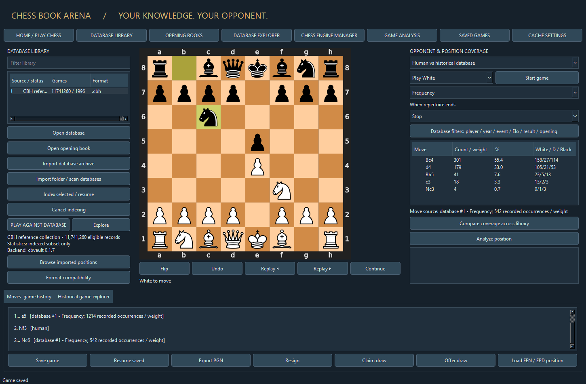
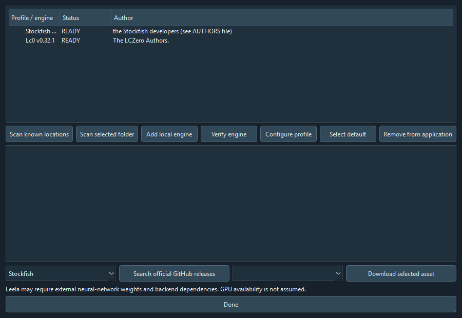

# CHESS BOOK ARENA 0.2.0

Windows desktop chess database workstation. Open classic ChessBase **CBH multi-file databases directly**, retrieve annotated games by native ID, build incremental position indexes, and play legal historical continuations. Select Stockfish, Leela Chess Zero or another verified UCI profile independently of the selected database.

[Download Windows installer / portable ZIP](https://github.com/chatgptopenaiagi/CHESS-BOOK-ARENA/releases/tag/v0.2.0) · [Compatibility matrix](docs/FORMAT-COMPATIBILITY-0.2.0.md) · [ChessX investigation](docs/CHESSX-ARCHITECTURE-RESEARCH.md) · [Native architecture](docs/NATIVE-READER-ARCHITECTURE.md)

## Open a ChessBase database

1. Launch `CHESS-BOOK-ARENA.exe`. Choose **Open database**, then the collection's **`.cbh` entry point**. Keep its companion files in their original directory. The file chooser now recognizes native database entry points.
2. Review the properties dialog. Missing required companions are reported. Opening reads native metadata without exporting the database to PGN. The source panel distinguishes eligible source records from cached/indexed games.
3. Use **DATABASE EXPLORER** to retrieve a native game by record ID. **Native player search** searches source headers without requiring the move index; use a surname prefix of at least three characters. The optional year comes from the explorer year field. Up to 100 matching games are decoded for display, with individual failures reported.
4. Click **Index selected / resume** and choose a bounded record segment. Progress and cancel remain available. The next segment resumes after the last committed native ID. Move statistics and database play use **only the indexed subset**, not the entire eligible game count.
5. Select White/Black, move selection strategy, filters, and the coverage-ended policy. Click **PLAY AGAINST DATABASE**. Candidate counts, White/draw/Black results and move provenance come from the selected source. Engine fallback is explicitly labeled.
6. Save, close and reopen the application, then resume the game. Export PGN or replay/analyze positions. **GAME ANALYSIS** evaluates the current game in the background using the selected UCI profile.

The source remains read only. Text records, deleted records, decoding errors and analysis-only null markers are distinguished. PGNs containing analysis null mainlines are preserved for replay but excluded from historical statistics. Exact per-record diagnostics remain in the local catalog. No purchased database is shipped with the application; included native examples are generated fixtures.

## Engine manager

Open **CHESS ENGINE MANAGER** to scan bounded known locations or a trusted selected folder, add a local executable, verify UCI, configure supported options, create profiles, select a default, or remove a profile without deleting its executable. READY means a UCI handshake passed; optional neural-network/backend suitability can still depend on configuration.

**Search official GitHub releases** supports the allowlisted Stockfish and Leela repositories. Pick a Windows x64 asset, review its backend requirements, then download/verify it. Prefer a universal Stockfish or CPU Leela build where appropriate. GPU acceleration is not inferred from installed hardware. Leela may need a weights path and runtime dependencies. The tested Lc0 CPU package supplies a network and OpenBLAS runtime. Engines are optional and are not bundled in the application installer.

The mode selector additionally offers **Human vs selected UCI engine**, **Engine vs engine** and **Database vs database**. Automated opponents stop on coverage/game termination. The default engine and Black engine profile are selected separately for engine matches. Historical player mode is an observable repertoire simulation, not a claim to reproduce a player's strength or personality.

## Storage and scale

Settings, saved games and the default SQLite catalog live in `%LOCALAPPDATA%\ChessBookArena`. **CACHE SETTINGS** can copy the catalog into an empty user-selected location on another drive; the previous catalog is retained. Native source signatures cover companions, and changed files invalidate derived state. A per-record transaction preserves cancellation/recovery checkpoints. The segment dialog estimates cache requirements and checks free space. Full indexing is optional and can be expensive; see measured [CBA-002 results](docs/CBA-002-RESULTS.md).

## Build

PowerShell 7, Python 3.11–3.15 (tested 3.14), Rust 1.88+ and the Windows MSVC linker, PySide6 6.11, chess 1.11.2 and PyInstaller 6.22.3:

```powershell
python -m venv .venv
.\.venv\Scripts\python.exe -m pip install -e .[dev]
.\scripts\Build.ps1
```

`Build-Native.ps1` fetches the pinned cbvault revision into the ignored vendor directory; it never overwrites a different checkout. The Rust helper is bundled automatically by PyInstaller. Compile `scripts/installer.iss` with Inno Setup 7. Run `scripts/Verify-Installer.ps1 -Compiler <path-to-ISCC.exe>` for an isolated-identity install/launch/uninstall check that preserves an existing installation registration. Python, Rust and compiler tools are not needed by users of the finished distribution.

The portable ZIP must be extracted as a complete directory with `_internal`; run the executable inside it. The per-user installer uses the same runtime. Builds are unsigned. Licensing and source attribution are in [THIRD-PARTY.md](THIRD-PARTY.md) and `licenses/`.

## Delivery boundary

CBA-002 overall status is **PARTIAL**. Real CBH reading, sourced play, persistence and multiple UCI engines are verified. CTG, Scid and ChessBase archive adapters are not integrated. ABK has generated-file evidence only; 2CBH lacks a representative local real-file test. No million-game full-position-index benchmark, clean external Windows installation or broad DPI/accessibility certification is claimed. Existing chess rules, PGN/Polyglot routes and saved-game functionality remain in place.



